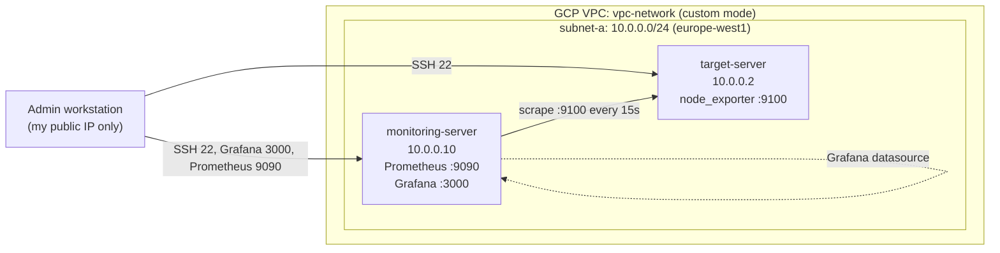

# GCP Monitoring Stack: Prometheus + Grafana with Terraform & Ansible

Infrastructure-as-Code project that provisions a small monitoring environment on **Google Cloud Platform** and configures it end to end, with no manual steps on the servers.

- **Terraform** builds the network, firewall rules and two Debian 12 VMs.
- **Ansible** installs and configures `node_exporter`, **Prometheus** and **Grafana** using reusable roles.

The same lab was first built on AWS EC2 (custom VPC); this repo is the GCP version, with the manual installation replaced by Ansible.

## Architecture



## What gets deployed

| Layer | Resource | Details |
|---|---|---|
| Network | VPC `vpc-network` | Custom mode (`auto_create_subnetworks = false`) |
| Network | Subnet `subnet-a` | `10.0.0.0/24` |
| Firewall | `allow-admin-ssh` | TCP 22, 3000, 9090 from the admin IP only, to `monitoring-server` |
| Firewall | `allow-ssh-target` | TCP 22 from the admin IP only, to `target-server` |
| Firewall | `allow-node-exporter-internal` | TCP 9100 from `monitoring-server` to `target-server` (tag-based) |
| Compute | `monitoring-server` | e2-small, Debian 12, static private IP `10.0.0.10` |
| Compute | `target-server` | e2-small, Debian 12, 10 GB disk, static private IP `10.0.0.2` |

### Ansible roles

| Role | Host | What it does |
|---|---|---|
| `node_exporter` | target-server | Creates a system user, downloads the pinned release, installs the binary and a systemd unit |
| `prometheus` | monitoring-server | Installs Prometheus and promtool, renders `prometheus.yml` from a Jinja2 template (targets generated from the inventory), **validates the config with `promtool` before applying**, runs as a systemd service with 7-day retention |
| `grafana` | monitoring-server | Adds the official Grafana apt repo, installs Grafana, **provisions the Prometheus datasource as code** |

Versions are pinned in each role's `defaults/main.yml` (node_exporter `1.8.2`, Prometheus `2.53.2`).

## Project structure

```
.
├── terraform/
│   ├── providers.tf              # Google provider (~> 6.0), Terraform >= 1.5
│   ├── vars.tf                   # project_id, region, zone, my_ip_cidr
│   ├── network.tf                # VPC, subnet, firewall rules
│   ├── vms.tf                    # monitoring-server and target-server
│   ├── outputs.tf                # public and private IPs
│   └── terraform.tfvars.example
└── ansible/
    ├── ansible.cfg
    ├── inventory.ini.example
    ├── sites.yml                 # main playbook
    └── roles/
        ├── node_exporter/
        ├── prometheus/           # includes templates/prometheus.yml.j2
        └── grafana/
```

## Prerequisites

- A GCP project with billing and the **Compute Engine API** enabled
- [Terraform](https://developer.hashicorp.com/terraform/install) >= 1.5
- [Ansible](https://docs.ansible.com/ansible/latest/installation_guide/) (ansible-core)
- `gcloud` CLI authenticated: `gcloud auth application-default login`
- An SSH key available to the VMs (project metadata or OS Login) for the user set in the inventory

## Usage

### 1. Provision the infrastructure

```bash
cd terraform
cp terraform.tfvars.example terraform.tfvars   # set project_id and my_ip_cidr
terraform init
terraform plan
terraform apply
terraform output                               # note the public IPs
```

### 2. Configure the servers

```bash
cd ../ansible
cp inventory.ini.example inventory.ini         # paste the public IPs and SSH user
ansible all -m ping                            # check connectivity
ansible-playbook sites.yml
```

### 3. Verify

- Prometheus: `http://<monitoring_public_ip>:9090/targets` (the `node` and `prometheus` jobs should be **UP**)
- Grafana: `http://<monitoring_public_ip>:3000` (default login `admin` / `admin`, change it on first login). The Prometheus datasource is already provisioned. Import dashboard ID **1860** (Node Exporter Full) to see the target server's metrics.

### 4. Clean up

```bash
cd terraform
terraform destroy
```

## Design decisions

- **Custom VPC instead of the default network**: explicit CIDR ranges and firewall rules, nothing open by default.
- **Least-privilege firewall**: management ports are reachable only from my own IP, and the exporter port is reachable only from the monitoring server using network tags.
- **Ansible instead of manual installs**: the whole stack is reproducible and idempotent, and can be rebuilt in minutes after a `terraform destroy`.
- **Config validated before deploy**: `promtool check config` runs as part of the Prometheus role, so a broken config never reaches the service.
- **Scrape targets generated from inventory**: adding a server to the `[target]` group adds it to Prometheus automatically.
- **No secrets in the repo**: `terraform.tfvars`, `inventory.ini` and state files are git-ignored; example files are provided.

